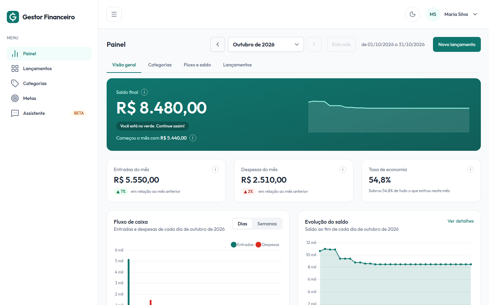
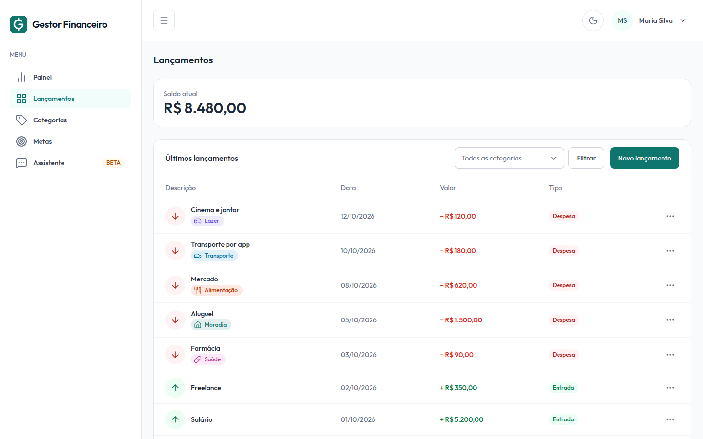
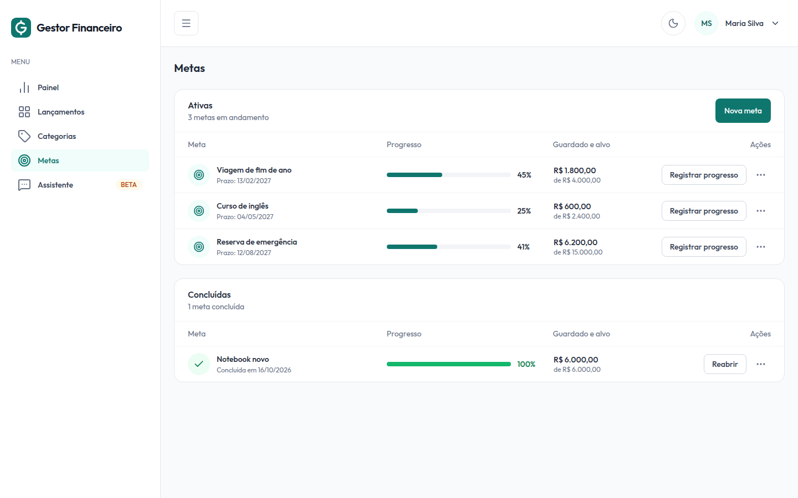
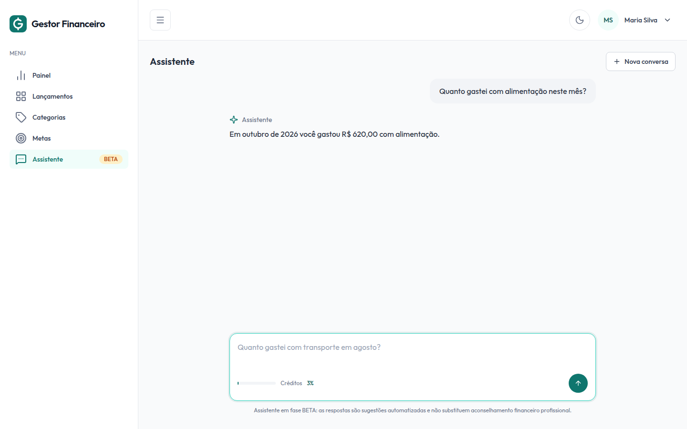

# Gestor Financeiro

[](https://github.com/leodramaral/projeto-gestor-financeiro/actions/workflows/ci.yml)

> **Projeto acadêmico.** Trabalho de estudo, feito para fins educacionais. Não é um produto comercial,
> não tem garantia de funcionamento e **não deve ser usado para gerir dinheiro real**.

## Sobre o projeto

O Gestor Financeiro é uma aplicação web de controle de finanças pessoais: a pessoa se cadastra, registra
entradas e despesas, organiza os gastos por categoria, acompanha tudo num painel com gráficos, define metas
e tira dúvidas sobre os próprios gastos com um assistente de IA.

**Stack:** Python 3.12, Django 5.2 (templates no servidor, sem SPA), PostgreSQL 16, Tailwind CSS 4,
Alpine.js e Chart.js. Tudo roda em Docker.

## Funcionalidades

- **Conta:** cadastro com confirmação por e-mail, login e recuperação de senha.
- **Lançamentos:** entradas e despesas, com edição, exclusão e filtro por categoria.
- **Categorias:** padrão e personalizadas, com ícone e cor.
- **Painel:** saldo, resumo do mês e gráficos de gastos por categoria, fluxo de caixa e evolução do saldo.
- **Metas:** valor-alvo, prazo opcional e barra de progresso.
- **Assistente de IA (beta):** responde perguntas sobre os gastos por categoria, só com os dados de quem pergunta.
- **Tema claro e escuro.**

| Painel | Lançamentos |
|---|---|
|  |  |
| **Metas** | **Assistente** |
|  |  |

*Dados fictícios.* O que o sistema promete hoje está em [`openspec/specs/`](openspec/specs/).

---

## Parte 1 — Rodar a aplicação

Só duas coisas na máquina: [Docker](https://docs.docker.com/get-docker/) com o **Compose v2**
(`docker compose`) e o [Git](https://git-scm.com/). Python, Node e PostgreSQL vivem nos contêineres.

```bash
git clone git@github.com:leodramaral/projeto-gestor-financeiro.git
cd projeto-gestor-financeiro
cp .env.example .env
```

Edite o `.env` (nunca é versionado) e preencha o que não tem valor padrão:

| Variável | O que fazer |
|---|---|
| `SECRET_KEY` | Gere uma chave com `docker run --rm python:3.12-slim python -c "import secrets; print(secrets.token_urlsafe(50))"`. |
| `POSTGRES_PASSWORD` | Qualquer senha, sem `@`, `:` ou `/` (quebram a URL do banco). |

O resto pode ficar como está. As variáveis `LLM_*` são opcionais e configuram o assistente (provedor
compatível com a API da OpenAI, padrão [Groq](https://console.groq.com) no plano gratuito; veja
[`.env.example`](.env.example)). Sem `LLM_API_KEY`, só a tela do assistente fica indisponível. Com o plano
gratuito, **não use dados financeiros reais**.

### Provedores do assistente

O assistente usa o SDK `openai` e funciona com provedores compatíveis com a API da OpenAI; para trocar de
provedor, mude só as variáveis `LLM_*` do `.env`. Estes funcionam e foram os testados:

| Provedor | `LLM_BASE_URL` | `LLM_MODEL` | Chave (`LLM_API_KEY`) |
|---|---|---|---|
| Groq | `https://api.groq.com/openai/v1` | `openai/gpt-oss-120b` | [console.groq.com](https://console.groq.com) |
| Gemini | `https://generativelanguage.googleapis.com/v1beta/openai/` | `gemini-3.1-flash-lite` | [aistudio.google.com/apikey](https://aistudio.google.com/apikey) |

Outros provedores compatíveis podem funcionar, mas não foram testados.

Suba tudo:

```bash
# Constrói a imagem, compila o CSS (serviço `css`), sobe o PostgreSQL e o Mailpit e inicia o Django em
# 127.0.0.1:8000, aplicando as migrações antes. Na primeira vez leva alguns minutos.
docker compose up --build
```

| O quê | Onde |
|---|---|
| Aplicação | <http://127.0.0.1:8000/> |
| Admin do Django | <http://127.0.0.1:8000/admin/> |
| Caixa de e-mail (Mailpit) | <http://127.0.0.1:8025/> |

**Primeiro acesso.** Crie a conta em `/accounts/signup/`. O e-mail de confirmação não sai da máquina: abra o
Mailpit, clique no link da mensagem e entre. Só contas confirmadas conseguem entrar. Para o admin:

```bash
docker compose exec web python manage.py createsuperuser
```

**Parar:** `Ctrl+C`, ou `docker compose down` (mantém o banco). `docker compose down -v` apaga também o banco.

### O que sobe

```
css      ──(termina com sucesso)──┐
db       ──(healthcheck ok)───────┼──▶  web  (Django, 127.0.0.1:8000)
mailpit  ──(iniciado)─────────────┘
```

| Serviço | Papel |
|---|---|
| `css` | Compila o Tailwind e copia Alpine, Chart.js e a fonte para `static/dist/`; **termina**, e o `web` só sobe depois. |
| `db` | PostgreSQL 16 com volume `pgdata`; o `web` espera o *healthcheck*. |
| `mailpit` | Caixa de entrada fake: recebe todo e-mail da aplicação em dev. |
| `web` | Roda `migrate` e o `runserver`; o código é montado em `/app`, então editar recarrega sem rebuild. |

### Problemas comuns

| Sintoma | Causa provável |
|---|---|
| `Set the SECRET_KEY environment variable` ao subir | `SECRET_KEY` vazia no `.env`. |
| `password authentication failed` depois de mudar a senha | O volume `pgdata` guarda a senha antiga: `docker compose down -v` e suba de novo (apaga os dados locais). |
| Página sem estilo | O serviço `css` falhou: `docker compose logs css`. |
| `port is already allocated` | Algo já usa a porta 8000. |

---

## Parte 2 — Fluxo de desenvolvimento

O projeto segue **Spec-Driven Development** com [OpenSpec](https://github.com/Fission-AI/OpenSpec): primeiro
se descreve e se aprova *o que* será feito, depois se implementa. **Não se implementa nada sem uma change.**

### Comandos do dia a dia

```bash
docker compose exec web python manage.py <comando>               # qualquer comando do Django
docker compose exec web pytest                                   # testes
docker compose exec web pytest --cov --cov-report=term-missing   # testes + cobertura (como o CI)
uvx pre-commit run --all-files                                   # lint, formatação e higiene (como o CI)
docker compose run --rm css npm run watch                        # recompila o CSS a cada edição (`build` para uma vez)
openspec validate --all                                          # valida as specs (sem --strict)
```

**Opcional, para um fluxo melhor:** instale o [GitHub CLI (`gh`)](https://cli.github.com/) e faça `gh auth login`.
Ele cria Issues (`gh issue create`) e abre PRs pelo terminal, e as skills `fechar-change`, `revisar-codigo` e
`tratar-review` dependem dele.

### Os três artefatos

| Artefato | Onde vive | Para que serve |
|---|---|---|
| **Issue** | GitHub | A demanda: *por que* o trabalho existe. |
| **Change** | `openspec/changes/<n>-<nome>/` | A proposta: `proposal.md`, `design.md`, `specs/` (deltas) e `tasks.md`. O id é o número da Issue + nome em kebab-case (`2-login-por-email`). |
| **Spec** | `openspec/specs/` | A verdade vigente do sistema, formada pelas changes arquivadas. |

### O ciclo

```
Issue ─▶ explore ─▶ branch ─▶ propose ─▶ apply ─▶ verificar ─▶ archive ─▶ PR (Closes #n)
```

1. **Issue** descrevendo o trabalho (`gh issue create`).
2. **Explorar** (`/opsx:explore`), se a intenção admite mais de uma leitura.
3. **Branch** com o id da change, a partir da `main`: `git checkout -b 2-login-por-email`.
4. **Propor** (`/opsx:propose`): gera proposal, design, specs e tasks. Ajustes: `/opsx:update`.
5. **Implementar** (`/opsx:apply`): cada task só é marcada depois de **concluída e verificada**. O que surgir
   no caminho vira task *antes* de ser feito, se está no escopo; se não está, vira Issue nova.
6. **Verificar:** `openspec validate --all`, `pytest`, `pre-commit` e a verificação manual das tasks.
7. **Arquivar** (`openspec archive <id> --yes`), ainda na branch e antes do PR.
8. **Pull Request** com `Closes #<n>` no corpo; só se mescla com o **CI verde**.

A skill `fechar-change` automatiza os passos 6–8. Se os comandos `/opsx:*` não aparecerem no Claude Code,
rode `openspec update` e reinicie.

### Commits

**Conventional Commits, em português**, com o número da Issue como escopo: `feat(#2): login por e-mail`.
Trabalho fora de change usa a área: `docs: ...`, `chore(docker): ...`. O título do PR segue o mesmo padrão.

Convenções de idioma, regras do repositório, worktrees e o design das telas (FigCraft, em [`design/`](design/))
estão em [`AGENTS.md`](AGENTS.md), a fonte única também lida pelos agentes de IA.

---

## Parte 3 — Quality gate

Duas camadas verificam o código: o **pre-commit**, a cada `git commit`, e o **CI** (GitHub Actions,
[`ci.yml`](.github/workflows/ci.yml)), a cada Pull Request e a cada merge na `main`. O ruleset da `main` exige
os três jobs verdes e uma aprovação.

| Job | Verifica | Reproduzir localmente |
|---|---|---|
| `quality` | Lint, formatação (linha de 100), complexidade ciclomática ≤ 10, regras de segurança (`S`, Bandit) e higiene de arquivos, com [Ruff](https://docs.astral.sh/ruff/) | `uvx pre-commit run --all-files` |
| `tests` | `pytest` com cobertura de linha e de branch, no mesmo Docker Compose do desenvolvimento | `docker compose exec web pytest --cov --cov-report=term-missing` |
| `openspec` | Formato das specs e changes (versão do OpenSpec fixada no workflow) | `openspec validate --all` |

- **Piso de cobertura:** `fail_under` no `pyproject.toml`. Abaixo dele o job falha mesmo com todos os testes
  passando; o piso só sobe, nunca é rebaixado para fazer um PR passar.
- **Pre-commit:** instale uma vez por clone com `uvx pre-commit install` (precisa do
  [`uv`](https://docs.astral.sh/uv/getting-started/installation/), só para esta ferramenta). As regras estão em
  [`.pre-commit-config.yaml`](.pre-commit-config.yaml) e no `pyproject.toml`, os mesmos arquivos do CI.
- **Job vermelho:** o link **Details** no PR abre o log; o erro está perto do fim. Um novo push reexecuta.
- **Exceção de lint:** só com justificativa, registrada no `pyproject.toml` (ou `# noqa: S<código>` com o
  motivo) e avaliada no PR.
- **Dependabot** abre PRs semanais de atualização (Python, npm, Docker, Actions); Django, Node, PostgreSQL e
  Python ficam nas versões LTS fixadas em [`dependabot.yml`](.github/dependabot.yml).
- **CodeQL** analisa o código em todo PR, em todo push na `main` e semanalmente. Ele **não bloqueia** o merge:
  leia os alertas do PR antes de mesclar.

### Teste de mutação

A cobertura diz se a linha rodou, não se algum teste confere o resultado. O
[mutmut](https://github.com/boxed/mutmut) faz pequenas alterações no código (`<` vira `<=`, `+` vira `-`, um
filtro perde um argumento) e roda os testes que passam por aquela função: se nenhum falha, o mutante
**sobreviveu** e há um teste que passa com o código quebrado.

```bash
scripts/mutation run                      # rodada completa (retoma de onde parou)
scripts/mutation run "transactions.views*"   # só os mutantes de um módulo
scripts/mutation results                  # lista os sobreviventes
scripts/mutation show <mutante>           # mostra o diff de um mutante
scripts/mutation browse                   # navegação interativa
scripts/mutation score                    # confere o score contra o piso
rm -rf mutants                            # descarta os resultados e recomeça do zero
```

- **Escopo:** todo o código dos apps é mutado, menos o que está em `do_not_mutate` (`[tool.mutmut]` no
  `pyproject.toml`): testes, migrations, `admin.py`/`apps.py`/`urls.py`, `config/`, templatetags de apresentação
  e comandos de desenvolvimento. Um arquivo novo entra por padrão; o critério para excluir está no
  [`AGENTS.md`](AGENTS.md).
- **Custo:** a rodada de referência (todos os mutantes do escopo) está em [`AGENTS.md`](AGENTS.md), com o tempo,
  a memória e o score. Os resultados ficam em `mutants/`, e uma nova rodada só refaz as funções alteradas.
- **Por que os limites:** o mutmut abre, por padrão, um processo por núcleo e ignora o teto de CPU do contêiner.
  Sem limite, a máquina fica sem processador. O `scripts/mutation` roda num contêiner com `cpus` e `mem_limit`
  (`MUTATION_CPUS`, padrão metade dos núcleos; `MUTATION_MEMORY`, padrão `2g`) e passa sempre
  `--max-children` (`MUTATION_MAX_CHILDREN`, padrão igual a `MUTATION_CPUS`).
- **Como ler um sobrevivente:** `scripts/mutation show <mutante>` mostra a alteração. Pergunte qual teste
  deveria ter falhado com ela. Se o comportamento importa, falta uma asserção. Se a alteração é equivalente
  (não muda nada observável), ela pode ser ignorada.
- **Fora do caminho do commit e do PR:** a rotina [`mutation.yml`](.github/workflows/mutation.yml) roda toda
  noite (e sob demanda, em **Actions → Mutação → Run workflow**). Se o score ficar abaixo do piso
  (`[tool.mutation] min_score`), ela abre uma Issue ou comenta na que já estiver aberta. O piso só sobe, como o
  `fail_under`.

CI verde não garante código correto: a revisão por outra pessoa e a verificação manual das tasks continuam
necessárias.

---

## Licenças

Layout do [TailAdmin](https://tailadmin.com) (versão gratuita, MIT; licença em `frontend/TAILADMIN-LICENSE`),
ícones da [Lucide](https://lucide.dev) (ISC; licença em `core/icons/LICENSE` e `transactions/icons/LICENSE`),
seletor de data [flatpickr](https://flatpickr.js.org) (MIT) e o empilhamento do toast, adaptado do
[Pines UI](https://devdojo.com/pines) (MIT; licença em `frontend/PINES-LICENSE`).
